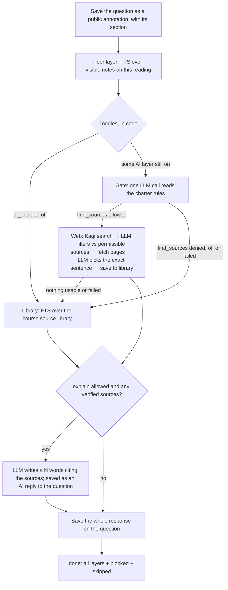

# How the backend works

A high-level tour of `app/backend/`, last brought up to date Saturday 05:40. `SPEC.md` says *what* we're building and §6 is the API contract; this explains *how the code is arranged* so you can find your way around and change it. If the code and this file disagree, the code wins: fix this file.

## The shape of it

The whole backend is **one Python process** (FastAPI, served by uvicorn) talking to **one SQLite file** (`app/backend/dialectic.db`). There's no ORM, no background workers and no cache server. Every request reads and writes the database directly with SQL, and the two outside services (the LLM and Kagi web search) are called with plain HTTP during the request.

```
browser / Mac app ──HTTP──▶ main.py (routes) ──▶ db.py (SQLite + full-text search)
                               │    │
                               │    ├─▶ sections.py  (headings → sections, at upload)
                               │    └─▶ locate.py    (Mac hotkey: which reading/page is this text?)
                               │
                               └─ /ask ──▶ ask.py ──▶ ai.py ─────▶ DigitalOcean LLM
                                                  └▶ search.py ─▶ Kagi search, web pages
                                         (every paid call goes through spend.py first)
```

In production the same process also serves the built React app (`app/frontend/dist`), so the whole site is one port behind Caddy.

## The files

| File | Lines | What it's for |
| --- | --- | --- |
| `main.py` | ~700 | Every HTTP route, plus small helpers that turn database rows into JSON. Start reading here. |
| `ask.py` | ~365 | The `/ask` flow: the three answer layers and the charter checks, in order, as a stream of progress events. |
| `ai.py` | ~365 | Everything that talks to the LLM: the four prompts, each call's effort and the model's prices (constants at the top), `chat()`, and the charter toggle checks. |
| `db.py` | ~310 | The schema (all `CREATE TABLE`s), `connect()`, the **visibility rule**, the **engagement lock**, `insert_annotation()`, and `fts_query()`, which turns free text into a search query. |
| `spend.py` | ~100 | Spending limits (SPEC §9.1): the per-device limit, the budgets, `AI_OFF`, and recording what each paid call cost. |
| `ocr.py` | ~105 | OCRs every upload (SPEC §3.11): finds scanned pages, strips their old text layer with `pikepdf`, runs `ocrmypdf --skip-text`. Run in a background thread by `POST /readings`. Also `box_text()`: the text inside a Select-area box (the PDF's text there, else Tesseract on that area). |
| `sections.py` | ~120 | Splits a reading into sections by its headings at upload, and finds which section a highlight is in. |
| `search.py` | ~200 | Kagi web search and fetching pages' main text (several at once), all cached in the database. The fetcher only reaches the public web (`get_public`, see `explainers/security.md`). |
| `semantic.py` | ~120 | Meaning search of readings (SPEC §3.8): cuts each reading into passages of a few sentences, embeds them with `bge-m3` on DO inference the first time a meaning search touches the reading (stored in `reading_passages`), and ranks passages by cosine similarity to the query. Readings only, never annotations. Model, passage size and score cutoff are constants at the top. |
| `locate.py` | ~85 | For the Mac hotkey: finds which reading and page a copied passage is from, and its highlight boxes in the PDF. |
| `seed.py` | ~260 | DEMO: the PHIL 247 seminar (the demo course): people, charter, proposals, Hobbes with notes, Wollstonecraft with none, and the Rousseau notes added when Rousseau is uploaded live. Calls the two below. |
| `seed_large.py` | ~420 | DEMO: the PHIL 101 lecture, ~70 people: Locke (rough scan, ~50 notes), Rousseau (~110), Mill (very rough scan, 3). |
| `seed_notes.py` | ~90 | DEMO: shared seed helpers: add a reading, add notes with replies spread over time, charter proposals. |
| `seed_asks.py` | ~150 | DEMO: six answered Asks. `--generate` runs them for real once and saves `seed/asks.json`; every reset replays that file offline. |
| `seed_dubois.py`, `seed_dubois_large.py` | | The previous Du Bois seed (HIST 214 + AMST 101), kept runnable: `uv run seed_dubois.py --reset`. |
| `seed/` | | The readings' PDFs (born-digital Rousseau and Hobbes; Locke, Mill and Wollstonecraft scans OCR'd by `ocr.py`), `asks.json`, and the Du Bois PDF. |
| `pyproject.toml`, `uv.lock` | | Dependencies, managed with uv. |

Dependencies: `fastapi` + `uvicorn` (web server), `python-multipart` (PDF upload), `pypdf` (page text and bookmarks), `pikepdf` (strip a scan's old text layer before OCR), `pdfplumber` (character positions, for highlight boxes), `httpx` (HTTP calls), `trafilatura` (extract an article's text from a web page).

## The routes at a glance

All under `/api`, all in `main.py`. The exact request and response shapes are in SPEC §6.

| Area | Routes |
| --- | --- |
| Who you are | `GET /users` (log-in list), `POST /login` (a professor's password for a token, when the copy has one), `GET /course` (course, reading cards with page/note/question counts, you, `uploads_enabled`) |
| Readings | `POST /readings` (professor upload), `GET /readings/{id}`, `GET /readings/{id}/pdf`, `POST /readings/{id}/box-text` (text in a Select-area box) |
| Annotations | `GET`/`POST /readings/{id}/annotations`, `DELETE /annotations/{id}` (with its replies), `PATCH /annotations/{id}` and `PUT /me/sharing` (share with future classes or not) |
| Asking | `POST /readings/{id}/ask` and `/ask/stream` (web reader), `POST /ask` and `/ask/stream` (Mac hotkey), `GET /questions/{id}/answer` (reopen an answer card) |
| Mac notes | `POST /note` (a note from the hotkey: the server finds the reading and page) |
| Charter | `GET`/`PUT /charter`, `POST /charter/comments`, `PATCH /charter/comments/{id}`, `GET /charter/gaps`, `POST /charter/gaps/dismiss` |
| Sources | `GET /sources`, `POST /sources` and `DELETE /sources/{id}` (professor) |
| Search | `GET /search?q=` (words), `GET /search?q=&mode=meaning` (meaning, if the charter's `ai_semantic_search` is on) |
| Spending | `GET /spend` (totals against this copy's budgets; no `X-User-Id` needed, so it opens on a phone) |

## How a request flows

1. The frontend sends every request with an **`X-User-Id`** header (who you've "logged in as"). Students have no password. On a copy with `PROFESSOR_PASSWORD` set, a professor also sends **`X-Professor-Token`**, which `POST /login` gave them for the password.
   - Two pieces of plain ASGI middleware at the top of `main.py` wrap every request: `LimitBodySize` (413 over 1 MB, or 50 MB for an upload) and `AddSecurityHeaders` (CSP and friends). Details in `explainers/security.md`.
2. FastAPI runs the route's **dependencies** first. In `main.py`:
   - `get_conn()` opens a database connection and closes it after the request.
   - `current_user()` looks up the user from the header: 401 if unknown, if it's the AI user, or if it's a professor without a valid `X-Professor-Token` while `PROFESSOR_PASSWORD` is set. The token is `user_id.expiry.HMAC` keyed by the password (`professor_token()`), so no session table.
   - `professor()` is `current_user()` plus a 403 for students. A route that takes `user=Depends(professor)` is professor-only, and that's the whole permission system. "Only the author" checks (delete, change sharing) are an `if` in the route.
3. The route runs its SQL, calls `conn.commit()` if it wrote anything, and returns a dict, which FastAPI sends as JSON.
4. The Ask routes also read an optional **`X-Device-Id`** header (a random id the web and Mac apps keep), for the per-device spending limit.
5. If anything raises, the `show_errors` handler returns a 500 with the **real error message** in `detail` (for example "DO_INFERENCE_KEY must be set"), so the frontend can show it instead of a vague failure.

## The data, in plain words

- **users**: name, role (`professor`, `student` or `ai`) and **cohort** (`Fall 2026` is the current class, `Spring 2026` is last year's). The AI is a user too ("Dialectic AI"), so its answers can sit in the margin like anyone else's.
- **annotations**: one table for everything people write on a reading:
  - `kind` is `note`, `question` or `ai_answer`.
  - `parent_id` makes something a reply (an AI answer is a reply to the question it answers).
  - `page`, `quote` and `rects` place the highlight: `rects` are boxes as *fractions* of the page size, so they redraw at any zoom. `section_id` is the section it falls in.
  - `via` is `web` or `hotkey` (asked or noted from the Mac app); `source_app` is the app the hotkey text came from (e.g. "Notability"), if the Mac app sent it.
  - `share_with_future`: whether later classes may see it. Its author can change it at any time.
  - `answer_json` (questions only): the finished `/ask` response, so the answer card can be reopened.
- **readings** + **reading_pages** + **reading_sections**: the uploaded PDF's path, each page's extracted text (for search, locating quotes and sections), and the headings found at upload. `readings.status` is `processing` while the upload is being OCR'd in the background, then `ready` (or `failed`, with `error`); until `ready` the reading has no pages and its notes/asks return 409.
- **charter**: one row holding the rules text, the permissible-sources description and the toggles. **charter_comments**: students' proposals, each with a `status` (`open`, `added`, `declined`) the professor sets. `db.migrate()` runs at server start and adds that column to an older database, so it needs no reseed.
- **sources**: the **course source library**. Every web page the AI used, plus any the professor added by hand.
- **charter_gaps**: search results the source filter skipped because the charter doesn't mention their kind (URL, title, kind; never who asked), for the charter page's gaps list.
- **spend**: one row per paid call that wasn't served from the cache: when, which service (`ai` or `search`), tokens or searches, the cost in USD, the device and the Ask it was for. `seed.py --reset` keeps it, so reseeding never resets a budget.
- **reading_passages**: meaning search's index: each reading's passages (page, text) and their embeddings as JSON lists of floats. Empty until the first meaning search touches a reading; `seed.py --reset` starts it again.
- **web_cache**: search results and fetched pages (keyed by query or URL), and the replies of the LLM calls, including the explanation (keyed by a hash of the exact prompt). It's demo insurance and speed: once a question has been asked, it replays the same gate verdict, search and sources much faster. `seed.py --reset` keeps this table.

The database runs in **WAL mode** with a 5-second **busy timeout** (`db.connect()`), so many people can read while someone writes, and two writers wait for each other instead of failing with "database is locked". It means the database has two side files, `dialectic.db-wal` and `-shm`; `seed.py --reset` deletes them with it. Each connection is opened with `check_same_thread=False`, because FastAPI may open a request's connection on one thread and close it on another (pages that load several things at once hit this); each request still has its own connection.

**Courses.** There can be several, and each person is in exactly one (`users.course_id`; the AI is in none). Readings, the charter, its comments and gaps, and the source library each carry a `course_id`. Routes use the logged-in user's course: `get_reading_or_404(conn, id, user)` 404s on another course's reading, and the charter, sources and search queries filter by `user["course_id"]`. `/ask` uses the charter of the reading's course.

There are **no migrations**: `CREATE TABLE IF NOT EXISTS` runs only when `seed.py --reset` builds a fresh database. After a schema change, everyone runs `uv run seed.py --reset` (it keeps `web_cache`).

### Full-text search (FTS5)

SQLite's FTS5 keeps a word index alongside three tables: `annotations_fts`, `sources_fts` and `pages_fts`. Triggers in `db.py` update the index whenever an annotation or source is inserted or deleted, so you never maintain it by hand (a deleted annotation vanishes from search immediately, as the privacy promise says). `pages_fts` is filled once, at upload.

`db.fts_query("Where does double-consciousness come from?")` drops common words and builds `"double" OR "consciousness"`. Results are ranked with `bm25()`, where a lower score is a better match.

### The visibility rule

Who sees which annotation is one SQL snippet, `db.VISIBLE_SQL`, used by every query that returns annotations (the margin, `/ask`'s peer layer, `/search`, the course counts and reopening answers). You see an annotation if:

- it's from **your cohort**, or
- its author is the **professor or the AI**, or
- it's from a **past cohort**, its author left "share with future classes" on, **and** the charter's `show_past_cohorts` toggle is on.

If this rule needs to change, change it there and everything follows.

### The engagement lock

On top of the visibility rule, the charter's `annotate_before_peers` toggle (on by default) hides classmates' annotations until you've engaged near them (SPEC §3.4). `db.full_view_ids(conn, user, reading_id)` returns the ids you see **in full**: the professor's, your own, any near one of your own notes or questions, threads holding a classmate's answer one of your Asks showed you (read from your questions' `answer_json`, which `ask.py` saves as soon as the peer layer is done), and replies or AI answers under one of those. Everything else visible is **locked**, and `GET /readings/{id}/annotations` sends it as `{id, page, rects, locked: true, group, group_notes}`, with no author, text or replies, so nothing leaks to the browser. Search leaves locked annotations out entirely, and a locked question's answer can't be reopened.

**Near** is measured by position: same page, and at most `db.NEAR_DISTANCE` (0.08 of the page height, about a paragraph) of vertical gap between the two highlights' outer boxes. Tune that one constant. Locked annotations near each other are grouped (`db.locked_groups`), so the reader draws one lock card per group: "N notes near here" from `group_notes`. It's a count of notes, not people: nothing about who wrote them leaves the server.

Nothing about unlocking is stored: it's recomputed from your own annotations on every request, so deleting your note locks its neighbours again.

The Ask panel is different on purpose: it shows every matching classmate note in full, wherever it is, because asking is engagement (SPEC §3.5). It doesn't unlock anything in the margin.

## `/ask`, step by step

This is the heart of the product, in `ask.answer_steps()`. It's a **generator**: it `yield`s an event as each step finishes (`question`, `status`, `peer`, `blocked`, `sources`, `ai_answer`, then `done` with the whole response).

- The **streamed routes** (`/ask/stream`) send each event as one JSON line straight away (`main.stream_events`), which is what lets the Ask panel say "Checking the charter…" and show classmates' answers in under a second. They open their own database connection, because the stream keeps running in another thread after the route function has returned. If something crashes mid-stream, the last line is `{"event": "error", "detail": ...}`.
- The **plain routes** call `ask.answer()`, which runs the generator to the end and returns `done`'s response.
- When it finishes, the whole response is **saved on the question** (`answer_json`). The question's margin card shows a summary from it (`answer_summary`: "Answered: 2 classmates, 1 source, AI context"), and `GET /questions/{id}/answer` reopens the card later, for anyone who can see the question in full.



The points worth knowing:

- **Peers come first and need no AI.** The peer layer only searches `note`s (including replies), not other questions or AI answers and not the asker's own notes, and boosts notes in the same section (same page for a reading uploaded before sections existed).
- **A failed or refused AI step doesn't sink the answer.** If the gate, the web layer or the explanation throws, `ask.failed_block` turns it into a `blocked` entry: `by: "limit"` with the notice as its `label` if a spending limit refused it (below), otherwise `by: "error"` with the real message (the AI service or Kagi down, or a bug; the traceback is logged). The sources fall back to the library, and the rest still arrives. Failures outside the AI steps still fail the request: a 500, or a last `error` line on a stream.
- **Partial refusals are normal.** The gate judges each layer on its own, so "What does Du Bois *mean* by…" gets sources (rule 2 lets AI point to sources) but no explanation (rule 2 forbids interpreting), when `GATE_CONTEXT_ONLY` is off; with it on, it gets a context-only explanation (next point). The answer then contains only the allowed layers, and `blocked` says which part was refused and why. A layer counts as allowed only if the gate says exactly `true`; anything else denies it.
- **Context-only explanations.** With `GATE_CONTEXT_ONLY = True` (top of `ai.py`, the default), a question the charter doesn't fully allow ("why did Du Bois use this phrase?") no longer loses its explanation when the phrase has history worth knowing: the gate answers `allowed: true, context_only: true`, and `ask.py` passes that verdict to `ai.explain`, which adds `EXPLAIN_CONTEXT_ONLY_NOTE` to the prompt. The explanation then opens with one sentence on what it won't answer and by which rule, and gives only the background. Set the constant to `False` for the old behaviour, where such a question blocks the explanation.
- **Two kinds of "no"** from the charter. A toggle that's off blocks a layer *in code*, before any model call (`ai.toggle_blocks`). The **gate** (`ai.gate`) is an LLM call that reads the charter's rules text and can deny a layer citing a rule number; `ai.rule_label` turns "2" into "Rule 2: AI may point us to sources…". Either way the layer is added to `blocked`, and the request still succeeds.
- **The source filter is a simple decision per result.** `ai.filter_sources` asks the model to sort every search result into `keep` (with a usefulness rating), `ruled_out` (the charter explicitly excludes this kind of source), `not_covered` (the charter doesn't mention it) or `off_topic` (including copies of the reading itself), plus a short label like "study-guide sites". The student-facing text is built from that label in code: "Your charter rules out study-guide sites" vs "Your charter doesn't mention journal articles". The second invites the class to amend the charter: `ask.log_charter_gaps` saves those results to `charter_gaps`, and `GET /charter/gaps` groups them by kind for the charter page (`ideas/01-charter-gaps.md`). Changing the permissible-sources text clears the list.
- **Sites that refuse us don't break the answer.** Britannica and The Atlantic answer our fetcher with 403, and JSTOR serves a landing page with no article text. So all kept pages are fetched at once, the 5 most useful that open are read, and only pages where the AI finds a real answering sentence become sources (at most 3). Everything else is listed in `skipped_sources` with a `why`: `not_permitted` / `not_covered` (shown, not linked), or `unreachable` / `no_answer` (linked, so the student can read it themselves).
- **The AI can't invent quotes.** When it picks "the sentence that answers the question" from a source, `ai.pick_sentences` checks that the sentence really appears in the page text and drops it otherwise. Kept sentences become text-fragment links (`url#:~:text=…`), which make the browser scroll to and highlight that sentence. If the sentence has citations or numbers, `ask.text_fragment_url` adds a second `text=` for its longest plain stretch: sites often hide screen-reader text inside citations, and a link term that crosses hidden text doesn't match, so the second one still lands on the sentence (#5). `search.download_page` also drops screen-reader-only elements before extracting, so quotes read as the page does ("Du Bois (1897", not "Du Bois (Reference Du Bois1897"). Some sites ignore text fragments altogether (Cambridge Core); the link then opens at the top of the page.
- **If the web gives nothing usable, the library is the fallback**, the same as when AI is off.
- **The library grows by itself.** Every source the AI uses is saved to `sources`. Later questions, including ones where AI is off or denied, find it with plain full-text search.
- **No ungrounded answers.** The explanation only cites sources with a verified sentence (library sources go through the same sentence-picking first), and it sees the text *around* each verified sentence, not just the start of the page. If there's nothing verified, there's no explanation and `blocked` gets a `no_sources` notice instead of a silent gap.
- **The explanation is context only.** It doesn't end with a question or suggest what to ask next (students write their own questions). The model is asked for 20 words fewer than the charter's limit, and if it still runs long, `ai.cut_to_words` cuts it short.
- **Speed.** A full AI answer is **four LLM calls** (gate, filter, pick sentences, explain) plus a search and the page fetches. By default the model "thinks" in 700–1,300 hidden tokens before every answer, which is most of the time. Each call's effort is a one-word constant at the top of `ai.py` (`GATE_EFFORT`, `FILTER_EFFORT`, `PICK_EFFORT`, `EXPLAIN_EFFORT`): `None` is full reasoning, `"low"` skips it. Only the sentence pick runs at low: its mistakes are caught (a misquoted sentence fails the substring check) or cheap (a missed one drops one source). The filter went back to full effort because at low it sometimes dropped allowed sources, a mistake nothing catches. The filter and sentence pick also use a **JSON schema** the API forces the reply into (without one, at low effort the model sometimes writes prose after its JSON). Measured: **about 22–25 s the first time** a question is asked (classmates' answers in under a second, sources around 15–18 s, the explanation last) and **about 7–8 s on replay**. So rehearse the demo questions once before presenting.
- **One retry, for one thing.** An **empty reply** from the model is asked again once (`EMPTY_REPLY_RETRIES` in `ai.py`); nothing else is retried.

## Spending limits (`spend.py`, SPEC §9.1)

The AI (DigitalOcean, prepaid credit) and web search (Kagi, $0.012 a search) cost money, and anyone with the URL can ask. So every **paid** call goes through a `spend.Meter`, one per Ask, which `ask.answer_steps` creates right after saving the question and passes down to `ai.chat_once()` and `search.search()`:

- **Before** the call, `meter.check(service)` raises `spend.LimitReached` (the notice is its message) if `AI_OFF=1`, if this device has started `DEVICE_ASKS_PER_HOUR` paid Asks in the last hour (`0` = no limit), or if the service's total has reached `AI_BUDGET_USD` / `SEARCH_BUDGET_USD` (that one is the subclass `BudgetExceeded`).
- **After** the call, `meter.record()` writes a `spend` row and commits it at once: the model's cost comes from the reply's `usage` token counts × `LLM_USD_PER_MTOK_IN` / `LLM_USD_PER_MTOK_OUT` (top of `ai.py`), a search costs `KAGI_USD_PER_SEARCH` (top of `search.py`).
- **Cached calls never reach the meter**: they're answered from `web_cache` before `chat_once` or `search` is called. Every LLM call is cached by its prompt, the explanation too (`ai.explain`), so a rehearsed question replays free and word for word, even when the budget is gone or AI is off, and it doesn't count against the device limit.
- **The device limit counts Asks, not calls**: distinct `question_id`s with spend from that `X-Device-Id` in the last hour. An Ask that has already paid once is allowed to finish. A request without the header counts as one shared device, `unknown`. It's not by IP address: at the venue everyone shares one.
- The settings are read from the environment on every check, so a missing one shows up as an `error` notice naming the variable to copy from `.env.example`, rather than quietly meaning "no limit". Changing one needs a restart of that copy's service (the `.env` is read at start).

## The Mac hotkey: `/api/ask` and `/api/note`

The Mac app (§3.9, built separately in `app/mac/`) only knows the text the student selected and their question or note. `main.locate_quote` does two things first:

1. **Find the page.** `locate.find_page` uses full-text search to shortlist pages, then checks which one really contains the quote. Text copied out of Preview or Notability never matches the PDF's text exactly (curly vs straight quotes, line breaks, dashes, "fi" ligatures), so `locate.squash()` compares **letters and digits only**: `one’s self,—` and `one's self -` both become `onesself`. A passage that isn't in any reading gets a 404.
2. **Find the highlight boxes.** `locate.quote_rects` does the same squashed matching over pdfplumber's per-character positions, then merges the characters into one box per line. The seed uses this too, for last year's annotations.

Then:

- **`POST /ask`** (and `/ask/stream`) runs exactly the same `ask.answer_steps()` as the web reader with `via="hotkey"`, so the question and AI answer show up in the web reader's margin. It adds `located` (reading, page, section and a `reader_url` that opens the web reader at the question); the stream sends it as its own event right after the question is saved.
- **`POST /note`** saves a plain note at the located place (`via="hotkey"`) and returns it with a `reader_url`.
- **`POST /locate`** is for the Mac highlight overlay: it gets a few lines the Mac read off the screen (not one passage), so `locate.find_page_from_lines` lets each line vote for its page. It returns that page's lines with their boxes (`locate.page_lines`, split at wide gaps so two-column pages match how the screen reads), and the Mac fits them to the screen and draws the class's highlights there. Before this route existed the Mac used a stub pinned to the old Du Bois reading 1, page 2, which stopped working when the philosophy seed replaced it.

## Sections

At upload, `sections.add_sections` takes the PDF's bookmarks if it has any, otherwise lines that look like headings: short, on their own line, Title Case or ALL CAPS, with a number line like "I." joined to the line after it. Running headers don't count: a line in the top three of a page whose text, minus a page number at either end, also tops another page ("OF OUR SPIRITUAL STRIVINGS 3", "6 THE SOULS OF BLACK FOLK"; OCR misreads the number as "T" or "il", so any one- or two-character end word counts as one). Neither does OCR noise: a heading needs three letters, no stray symbols, and a vowel in every word. Fewer than two headings means one section per page, titled "Page N". The demo scan gets the book title on page 1 plus "1 OF OUR SPIRITUAL STRIVINGS", which every seeded note falls in.

`sections.section_for` places a highlight: the last section that starts on an earlier page, or on the same page with its heading before the quote in the page's text. Notes (web or hotkey), questions and the seeded annotations look it up when saved; replies copy their parent's.

## Privacy, by construction

The functions in `ai.py` only take **strings**: charter text, the quote, the question, the reading title and source text. No route passes them a user, an id or another student's annotation, so none of that can leak into a prompt. Kagi receives only the gate's `search_query`, and fetched sites see a generic user agent. The spending meter is passed along with the AI calls but never goes into a prompt, and `GET /spend` shows totals only, nothing per device. Locked annotations leave the server as positions and a count only, and `charter_gaps` stores sources, never who asked.

## DEMO shortcuts (on purpose)

- **Seed annotations appear on upload.** The demo starts with the professor uploading the reading live, so last year's annotations can't exist beforehand. `POST /readings` asks `main.demo_seed_for(file name, course)`: if it's `rousseau-social-contract.pdf` uploaded into PHIL 247 (or, with the old seed, `souls-of-black-folk-ch1.pdf` into HIST 214), the background thread skips OCR and calls that seed's `add_demo_annotations()`. The highlight boxes are computed from the real PDF with pdfplumber.
- **`seed.py --reset --with-reading`** sets up the same state without the live upload, in case it fails on stage.
- **`seed.py --reset --with-sources`** preloads the library with the SEP entry on Rousseau and Wikipedia's "General will", in case web search fails on stage. Add both flags to get everything.
- **Anyone can be any student:** `X-User-Id` is trusted as is for students. The professor needs `PROFESSOR_PASSWORD` when the copy sets it (the public one does); without it, anyone can be the professor too.

## Where to change things

| To change… | Edit |
| --- | --- |
| What the AI is told (gate, filter, sentence, explanation) | The `*_PROMPT` constants at the top of `ai.py` |
| Whether an interpretive question gets a context-only explanation or a refusal | `GATE_CONTEXT_ONLY` in `ai.py` |
| What the AI and search cost | `LLM_USD_PER_MTOK_IN`, `LLM_USD_PER_MTOK_OUT` in `ai.py`; `KAGI_USD_PER_SEARCH` in `search.py` |
| Budgets, the per-device limit, the emergency stop | `AI_BUDGET_USD`, `SEARCH_BUDGET_USD`, `DEVICE_ASKS_PER_HOUR`, `AI_OFF` in that copy's `.env` (then restart it) |
| The professor password, uploads on or off | `PROFESSOR_PASSWORD`, `UPLOADS_ENABLED` in that copy's `.env` (then restart it) |
| Body and text limits, the CSP | `MAX_BODY_BYTES`, `MAX_UPLOAD_BYTES`, `MAX_TEXT_CHARS`, `SECURITY_HEADERS` at the top of `main.py` |
| What the page fetcher may reach | `FETCH_PORTS`, `BLOCKED_NETWORKS`, `MAX_REDIRECTS`, `MAX_PAGE_BYTES` at the top of `search.py` |
| The limit notices students see | `AI_OFF_NOTICE`, `DEVICE_LIMIT_NOTICE`, `BUDGET_NOTICE` in `spend.py` |
| How hard each AI call thinks | `GATE_EFFORT`, `FILTER_EFFORT`, `PICK_EFFORT`, `EXPLAIN_EFFORT` in `ai.py` |
| The wording of "blocked by toggle" notices | `TOGGLE_LABELS` in `ai.py` |
| The Ask panel's progress lines, the "something went wrong" label | `STAGE_LABELS`, `AI_ERROR_LABEL` in `ask.py` |
| How many peer / library / web results, the same-section boost | Constants at the top of `ask.py` |
| Seed users, charter text, demo annotations | Constants at the top of `seed.py` |
| Who can see what | `VISIBLE_SQL` in `db.py`; the engagement lock is `full_view_ids`, `locked_groups` and `NEAR_DISTANCE` there too |
| What counts as a heading | Constants and `looks_like_heading` at the top of `sections.py` |
| How long the charter gaps list looks back | `GAPS_DAYS` in `main.py` |
| Which words search ignores | `STOPWORDS` in `db.py` |
| A route or response shape | `main.py`, **and** `SPEC.md` §6 in the same commit |

## Running and poking it

From `app/backend`:

```sh
uv run seed.py --reset --with-reading
uv run --env-file ../../.env uvicorn main:app --reload --port 8000
```

Your `.env` needs the four spending settings from `.env.example` (`AI_BUDGET_USD`, `SEARCH_BUDGET_USD`, `DEVICE_ASKS_PER_HOUR`, `AI_OFF`), or every AI step shows an error notice saying which one is missing. `curl localhost:8000/api/spend` shows what's been spent so far.

Then try it in another terminal (user 1 is Prof. Rivera, 2 is Ana, 3 is Ben, 4 is Sam), or open <http://localhost:8000/docs> for FastAPI's clickable list of every route:

```sh
curl -H 'X-User-Id: 3' localhost:8000/api/readings/1/annotations
curl -X PUT -H 'X-User-Id: 1' -H 'Content-Type: application/json' -d '{"ai_enabled": false}' localhost:8000/api/charter
# Watch the staged answer arrive line by line (-N: don't buffer):
curl -N -H 'X-User-Id: 2' -H 'Content-Type: application/json' \
  -d '{"quote": "born with a veil, and gifted with second-sight", "question": "Where does the idea of a seventh son born with a veil come from?"}' \
  localhost:8000/api/ask/stream
```

## Known gaps (as of 05:40 Sat)

- **The real gate passes the demo questions** (each tried three times, same verdict every time): "what did it mean in 1903?", "where did the term come from?" and the hotkey question are allowed; "what does Du Bois *mean* by…" is partly refused, as intended.
- **A flaky site can change a replay once.** Fetch failures aren't cached, so a page that refused us once and opens on a later try changes that question's sources, and that one run pays for a new sentence pick and explanation.
- **The cache replays bad luck too.** A question's gate verdict, filter and sentences are cached by their exact prompt. If a question's first run was unlucky (e.g. every good page refused us), it stays that way until its `llm:` rows are deleted from `web_cache`. Clearing them means the gate writes a new search query. Checking the rehearsed answers is an open item in `TODO.md`.
- **Saved answers are snapshots.** Reopening an answer card shows the classmates and sources as they were when it was asked, even if a note was deleted since.
- **The sentence pick only reads the first 6,000 characters of each page,** so an answer deeper in a long page is missed (the page lands in `no_answer`).
- **A quote that runs across a page break** isn't found by the hotkey routes, and on the web gets the section of its first page.
- **The Mac app doesn't send which app the text came from yet** ("from Notability"): the server accepts and returns `source_app`; `TODO.md`, owner josoup.
- **`main.py` is past the ~400 lines** at which SPEC §4 says to split it. Left alone until after the demo, so nobody's edits collide.
- **Budgets can overshoot by one Ask.** The check is "has the total reached the budget?" before each call, so the calls of Asks already running when it's reached still go through: a few cents, not dollars.
- **The device limit is per device id**, which a student can reset by clearing browser storage. It's for fairness; the budget is the real cap.
